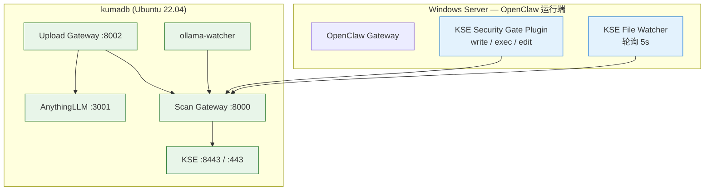

# kse-ai-gateway

[](LICENSE)
[](https://github.com/prellfn/kse-ai-gateway)
[](https://support.kaspersky.com/ScanEngine)

**kse-ai-gateway** 是一套面向 AI Agent 的安全网关与防护体系：基于卡巴斯基扫描引擎
（Kaspersky Scan Engine, KSE），把 AI Agent 的所有高危操作——**工具调用、Skill 下载、脚本执行、
模型加载、知识库文档上传**——统一交给 KSE 扫描判定，实现「**Agent 不裸跑，恶意内容不过网**」。

本仓库包含已在生产环境验证过的完整实现：**Linux 侧网关 + systemd 服务 + Windows 侧 Agent 插件
+ 双端文件监控 + Ollama 模型监控**。

---

## 目录

- [它解决什么问题](#它解决什么问题)
- [整体架构](#整体架构)
- [五种防护场景](#五种防护场景)
- [仓库结构](#仓库结构)
- [快速开始](#快速开始)
- [核心 API](#核心-api)
- [配置](#配置)
- [判定与处置策略](#判定与处置策略)
- [安全设计原则](#安全设计原则)
- [文档](#文档)
- [路线图](#路线图)
- [许可证](#许可证)

---

## 它解决什么问题

AI Agent（OpenClaw、Codex、WorkBuddy、OpenCode 等）在执行任务时会下载第三方 Skill、运行脚本、
加载模型文件、调用外部工具、写入知识库。这意味着**不受信任的内容会直接进入执行环境或数据资产**：

| 风险 | 场景 |
| --- | --- |
| 供应链投毒 | 恶意或被篡改的 Skill / Plugin 包（夹带木马、后门脚本） |
| 高危脚本落地 | Agent 生成或拉取的脚本中夹带恶意载荷，落地后被直接执行 |
| 模型投毒 | 被劫持的模型仓库 / 权重文件（`.gguf`、`.safetensors`） |
| 知识库污染与宏病毒 | 上传到 RAG / 知识库的文档携带恶意负载或宏代码 |
| 工具返回投毒 | MCP / 工具调用返回的附件或载荷被污染，影响下游系统 |

kse-ai-gateway 在 Agent 与这些操作之间插入一道**强制安全检查点**：所有内容先经 KSE 扫描，
判定通过才放行。

---

## 整体架构



**部署形态**：网关与 KSE 部署在同一台内网主机，网关通过本机回环调用 KSE；Agent 侧只需把请求
指向网关（插件 / 代理 / 目录监听），无需侵入式改造 Agent 本体。

| 组件 | 部署方式 | 端口 | 作用 |
| --- | --- | --- | --- |
| KSE | 原生 systemd | 8443 (HTTPS) / 443 (Web UI) | 卡巴斯基扫描引擎核心 |
| Scan Gateway | Python + systemd | 8000 | KSE 封装层：路径白名单、SHA256 缓存、威胁自动隔离、审计 |
| Upload Gateway | Python + systemd | 8002 | 安全上传页面，先扫再入库 |
| ollama-watcher | Bash + systemd | — | 监控模型下载目录，自动隔离检出威胁 |
| OpenClaw Plugin | Node.js 插件 | — | 事前拦截 write / edit / exec |
| KSE File Watcher | PowerShell 计划任务 | — | 事后兜底扫描 skills / plugins / npm |
| AnythingLLM | Docker | 3001 | 知识库前端 |

---

## 五种防护场景

| 场景 | 类型 | 触发方式 | 处置 | 状态 |
| --- | --- | --- | --- | --- |
| OpenClaw `write` | 事前拦截 · 内存扫描 | Agent 调用 write 工具 | 阻止写入，不落盘 | ✅ 已验证 |
| OpenClaw `exec` | 事前拦截 · 脚本/模型/Skill | Agent 调用 exec 工具 | 阻止执行 | ✅ 已验证 |
| Ollama 模型监控 | 事后扫描 · inotifywait | 模型文件写入 blobs | 自动隔离 | ✅ 已验证 |
| Upload Gateway | 上传拦截 · Web 页面 | 用户上传文件 | 拒绝入库 | ✅ 已验证 |
| File Watcher | 事后扫描 · 定时轮询 | skills/plugins/npm 安装 | 自动隔离 | ✅ 已验证 |

### 1️⃣ 工具调用拦截（事前 · 不落盘）

插件挂载在 OpenClaw 的 `before_tool_call` Hook 上。Agent 写文件时，**文件内容先在内存中被扫描**，
检出威胁直接返回 `block: true`，文件根本不会落到磁盘上。

```
Agent → write(path, content)
       → Plugin → Scan Gateway → KSE
       → DETECT ⇒ { block: true, blockReason: "[Kaspersky] 检出威胁: EICAR-Test-File" }
```

### 2️⃣ 脚本执行拦截（事前 · 不执行）

`exec` 工具命中三类目标：**待执行脚本**（`.py/.js/.sh/.ps1/.exe`）、**待加载模型**
（`.gguf/.safetensors/.bin/.pt/.onnx`）、**Skill 下载命令**（`git clone` / `pip install` /
`npm install` / `curl` / `wget` + Skill 关键词）。

### 3️⃣ Ollama 模型监控（事后 · 自动隔离）

`ollama-watcher` 用 `inotifywait` 旁路监听 `models/blobs/`，新模型文件出现即调用 Scan Gateway，
检出威胁 `mv` 到隔离区并命名为 `{SHA256}_{时间戳}_{原文件名}`，Ollama 加载该模型会失败。

### 4️⃣ 知识库上传拦截

浏览器上传 → Upload Gateway 落盘扫描队列 → Scan Gateway → KSE → CLEAN 才转发 AnythingLLM
（两步上传：`document/upload` + `workspace/{slug}/update-embeddings`）。

### 5️⃣ skills / plugins 安装兜底（事后 · 自动隔离）

Windows 计划任务每 5 秒轮询 `workspace` / `plugins` / `npm` 目录，发现新文件即通过
`curl.exe` 上传到 Scan Gateway，检出威胁 Move-Item 到本地隔离区。

> 完整数据流时序图见 [`docs/architecture.md`](docs/architecture.md)；
> 交互式架构图见 [`docs/kse_architecture.html`](docs/kse_architecture.html)。

---

## 仓库结构

```
kse-ai-gateway/
├── gateway/
│   ├── scan-gateway/
│   │   └── app.py                 # :8000  KSE 封装层（路径白名单 / 缓存 / 隔离 / 审计）
│   ├── upload-gateway/
│   │   ├── app.py                 # :8002  安全上传 → AnythingLLM
│   │   └── templates/index.html   # 上传页面
│   ├── systemd/
│   │   ├── scan-gateway.service
│   │   ├── upload-gateway.service
│   │   └── ollama-watcher.service
│   └── requirements.txt
├── agent/
│   ├── openclaw-plugin/           # OpenClaw 插件：write / edit / exec 事前拦截
│   │   ├── index.js
│   │   ├── package.json
│   │   ├── openclaw.plugin.json
│   │   └── README.md
│   └── windows-watcher/
│       └── kse-file-watcher.ps1   # Windows 轮询监控 + 隔离
├── watchers/
│   └── ollama-watcher.sh          # Linux 模型目录监控 + 自动隔离
├── scripts/
│   ├── install_ubuntu.sh          # Linux 一键部署网关
│   └── backup_kse.sh              # 备份 / 恢复脚本
├── config/
│   └── gateway.example.yaml       # 全量配置示例
├── docs/
│   ├── install.md                 # 安装手册
│   ├── operations.md              # 运维手册
│   ├── architecture.md            # 架构拓扑与数据流
│   └── kse_architecture.html       # 交互式架构图
└── .env.example
```

---

## 快速开始

### 前置要求

- **Kaspersky Scan Engine 2.2.x**（已启用 HTTPS + Token，端口 8443）
- **Ubuntu 22.04 LTS**（网关侧）/ **Windows Server**（Agent 侧）
- Docker 20.10+（仅 AnythingLLM 需要）

### 1. 安装 KSE 并配置 Token

详见 [`docs/install.md`](docs/install.md) 第三、四章。要点：

> ⚠️ **必须用 Web UI 配置 Token，不要手动改 XML。**
> 调用 API 用的是**明文 Token**，不是 XML 里的 88 字节加密值。

### 2. 部署网关

```bash
git clone https://github.com/prellfn/kse-ai-gateway.git
cd kse-ai-gateway
sudo ./scripts/install_ubuntu.sh
```

脚本会完成：创建目录 → 安装 Python 依赖 → 部署 Scan Gateway / Upload Gateway → 注册 systemd 服务
→ 写入 `.env` 模板。部署后编辑 `.env` 填入 `KSE_TOKEN` 并重启：

```bash
sudo vi /opt/ai-stack/scan-gateway/.env
sudo systemctl restart scan-gateway upload-gateway
```

### 3. 验证

```bash
curl http://127.0.0.1:8000/health
curl http://127.0.0.1:8002/health

# EICAR 端到端测试
echo 'X5O!P%@AP[4\PZX54(P^)7CC)7}$EICAR-STANDARD-ANTIVIRUS-TEST-FILE!$H+H*' \
  > /opt/kaspersky/scanqueue/eicar.txt
curl -X POST http://127.0.0.1:8000/scan/file \
  -H "Content-Type: application/json" \
  -d '{"file_path":"/opt/kaspersky/scanqueue/eicar.txt","timeout":60}'
```

预期返回 `verdict: DETECT`，且文件已被移入 `/opt/kaspersky/quarantine/`。

### 4. 接入 AI Agent

- **OpenClaw** → 见 [`agent/openclaw-plugin/README.md`](agent/openclaw-plugin/README.md)
- **Windows skills 兜底** → 见 [`agent/windows-watcher/README.md`](agent/windows-watcher/README.md)
- **知识库上传** → 浏览器访问 `http://<host>:8002`

---

## 核心 API

### Scan Gateway（:8000）

| 方法 | 路径 | 说明 |
| --- | --- | --- |
| `POST` | `/scan/file` | 扫描本机文件（路径白名单内）。命中威胁自动隔离 |
| `POST` | `/scan/upload` | 上传文件内容扫描（跨机器调用的统一入口） |
| `POST` | `/scan/directory` | 批量扫描目录下所有文件，返回威胁汇总 |
| `GET` | `/health` | 健康检查（含 KSE 地址、缓存大小、允许目录） |

**请求示例**

```bash
# 路径扫描
curl -X POST http://127.0.0.1:8000/scan/file \
  -H "Content-Type: application/json" \
  -d '{"file_path":"/opt/kaspersky/scanqueue/sample.pdf","timeout":60}'

# 内容上传扫描
curl -X POST http://127.0.0.1:8000/scan/upload \
  -F "file=@./sample.pdf"
```

**响应示例（检出威胁）**

```json
{
  "request_id": "req_01j9x8k2m4",
  "file_path": "/opt/kaspersky/scanqueue/eicar.txt",
  "sha256": "275a021bbfb6489e54d471899f7db9d1663fc695ec2fe2a2c4538aabf651fd0f",
  "size": 68,
  "verdict": "DETECT",
  "detection_name": "EICAR-Test-File",
  "quarantined": true,
  "quarantine_path": "/opt/kaspersky/quarantine/275a021b..._1700000000_eicar.txt",
  "scanned_at": "2026-11-04T00:30:00+00:00"
}
```

### Upload Gateway（:8002）

| 方法 | 路径 | 说明 |
| --- | --- | --- |
| `GET` | `/` | 安全上传页面 |
| `POST` | `/upload` | 上传 → 扫描 → CLEAN 才入库 AnythingLLM |
| `GET` | `/health` | 健康检查 |

---

## 配置

所有配置通过**环境变量**注入（`.env`），模板见 [`.env.example`](.env.example)，
结构化示例见 [`config/gateway.example.yaml`](config/gateway.example.yaml)。

```bash
# ---- KSE ----
KSE_URL=https://127.0.0.1:8443
KSE_TOKEN=your-kse-plaintext-token     # 明文 Token，勿提交
KSE_TIMEOUT=120
KSE_VERIFY_TLS=false

# ---- 目录 ----
SCAN_QUEUE=/opt/kaspersky/scanqueue
QUARANTINE=/opt/kaspersky/quarantine
ALLOWED_SCAN_DIRS=/opt/kaspersky/scanqueue,/root/ai-stack/ollama/models/blobs
AUDIT_LOG=/opt/ai-stack/scan-gateway/logs/audit.jsonl

# ---- AnythingLLM ----
ANYTHINGLLM_URL=http://10.0.0.1:3001
ANYTHINGLLM_API_KEY=your-anythingllm-api-key
WORKSPACE_SLUG=your-workspace-slug
```

---

## 判定与处置策略

| KSE 返回 | 网关判定 | Upload Gateway | OpenClaw Plugin |
| --- | --- | --- | --- |
| `CLEAN` | clean | ✅ 放行入库 | ✅ 放行 |
| `DETECT` / `INFECTED` | malicious | ⛔ 拒绝 + 隔离 | ⛔ 阻止工具调用 |
| 启发式可疑 | suspicious | 🚧 隔离待审 | ⛔ 阻止 |
| 超时 / 扫描异常 | error | ⛔ **Fail-Closed** 拒绝 | ✅ **Fail-Open** 放行 |

> 两种 Fail 策略的取舍：Agent 侧优先保证业务不中断（事后由 Watcher 兜底）；
> 知识库侧优先保证数据不被污染（宁可拒绝入库）。

---

## 安全设计原则

- **默认拒绝（Fail-Closed）**：未知路由、超限文件、KSE 不可达或超时一律不放行。
- **最小暴露**：网关与 KSE 之间仅走本机回环；KSE API（8443）与 Scan Gateway（8000）
  不对公网开放，只允许内网访问。
- **路径白名单**：Scan Gateway 只扫描 `ALLOWED_SCAN_DIRS` 内的文件，杜绝任意路径读取。
- **全量审计**：请求来源、文件 SHA-256、KSE 检测名、耗时、处置动作写入 JSONL 审计日志。
- **隔离优先**：可疑文件自动移入隔离区，由管理员复核后再处置。
- **密钥不落库**：KSE Token / AnythingLLM API Key 只存于 `.env`（权限 600），仓库只保留模板。

---

## 文档

| 文档 | 内容 |
| --- | --- |
| [`docs/install.md`](docs/install.md) | 完整安装手册（11 步，含全部命令与验证） |
| [`docs/operations.md`](docs/operations.md) | 运维手册（服务管理、日志、故障排查、病毒库更新、备份恢复） |
| [`docs/architecture.md`](docs/architecture.md) | 架构拓扑与 5 条数据流时序图 |
| [`docs/kse_architecture.html`](docs/kse_architecture.html) | 交互式架构图（浏览器打开） |

---

## 路线图

- [x] KSE HTTP API 对接与判定解析
- [x] Scan Gateway（路径白名单 + 缓存 + 隔离 + 审计）
- [x] Upload Gateway（安全上传 → AnythingLLM）
- [x] OpenClaw 插件：write / edit / exec 事前拦截
- [x] Windows File Watcher：skills / plugins / npm 兜底扫描
- [x] Ollama 模型下载监控与自动隔离
- [ ] MCP Server 形态接入（Codex / Claude Code 等原生支持 MCP 的 Agent）
- [ ] URL 扫描链路（`/api/v3.0/checkurl`，拦截恶意链接与钓鱼 URL）
- [ ] Skill / 插件包解包逐文件深度扫描 + 压缩包炸弹防护
- [ ] 双向 TLS（mTLS）与多租户策略
- [ ] Web 轻量级安全监控与隔离复核台
- [ ] 审计日志查询 API 与统计报表

---

## 许可证

本项目采用 [MIT License](LICENSE) 开源许可证。
Kaspersky Scan Engine 为卡巴斯基商业产品，需自行获取许可证，本仓库不含任何 KSE 二进制或密钥。
