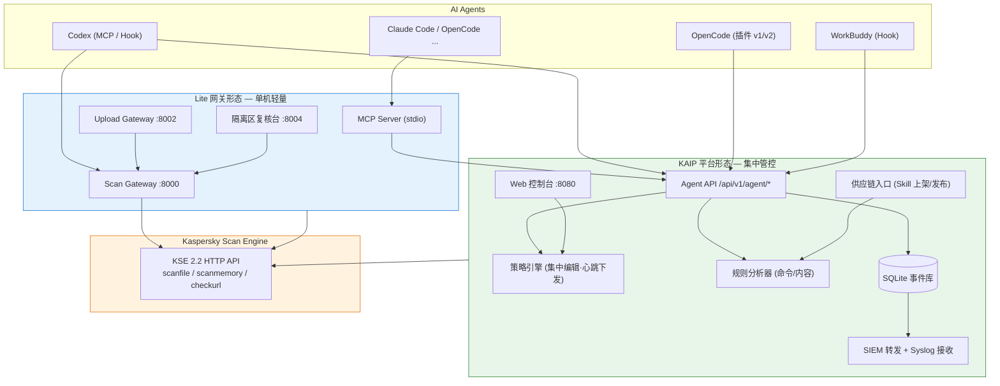

# kse-ai-gateway / KAIP

[](LICENSE)
[](https://support.kaspersky.com/ScanEngine)

**面向 AI Agent 的卡巴斯基安全防护体系** —— 以 Kaspersky Scan Engine (KSE) 为扫描内核，
对 AI Agent 的工具调用、Skill 下载、脚本执行、模型加载、URL 访问、知识库上传做强制安全检查。

本仓库是**统一代码库**，包含两种运行形态：

| 形态 | 目录 | 定位 | 适用 |
| --- | --- | --- | --- |
| **KAIP 平台形态** | [`platform/`](platform/) | 完整产品：集中管控、策略下发、多终端、审计台账、SIEM、自愈 | 企业内网、需要统一策略与审计 |
| **Lite 网关形态** | [`lite/`](lite/) | 零依赖轻量网关：单服务、无数据库、无需平台 | 只需扫描网关 / 极端受限环境 / 快速落地 |

两种形态共用同一个 KSE 引擎、同一套判定语义、同一份验证方法。

---

## 目录

- [它解决什么问题](#它解决什么问题)
- [体系架构](#体系架构)
- [仓库结构](#仓库结构)
- [两种形态怎么选](#两种形态怎么选)
- [AI Agent 接入](#ai-agent-接入)
- [快速开始](#快速开始)
- [验证](#验证)
- [真实环境落地记录](#真实环境落地记录)
- [文档](#文档)
- [路线图](#路线图)
- [许可证](#许可证)

---

## 它解决什么问题

AI Agent（Codex、OpenCode、WorkBuddy、Claude Code 等）在执行任务时会下载第三方 Skill、运行脚本、
加载模型文件、访问外部链接、写入知识库。这意味着**不受信任的内容会直接进入执行环境或数据资产**：

| 风险 | 场景 |
| --- | --- |
| 供应链投毒 | 恶意或被篡改的 Skill / Plugin 包（夹带木马、后门脚本） |
| 压缩包藏毒 | 整包扫描被免杀，但包内某个脚本带毒 |
| 高危脚本落地 | Agent 生成或拉取的脚本中夹带恶意载荷，落地后被直接执行 |
| 模型投毒 | 被劫持的模型仓库 / 权重文件（`.gguf`、`.safetensors`） |
| 钓鱼与恶意链接 | Agent 被诱导访问仿冒登录页、恶意下载站 |
| 知识库污染 | 上传到 RAG / 知识库的文档携带恶意负载或宏代码 |
| 工具返回投毒 | MCP / 工具调用返回的附件或载荷被污染，影响下游系统 |

防护体系在 Agent 与这些操作之间插入**强制安全检查点**：所有内容先经 KSE 扫描，判定通过才放行。

---

## 体系架构



**核心能力（两种形态共有）**

| 能力 | 说明 |
| --- | --- |
| 内容扫描 | 文件 / 文本 / 压缩包逐文件 / URL |
| 判定策略 | `CLEAN` 放行、`DETECT` 拦截、`RISK` 规则命中、`NON_SCANNED` 不放行 |
| Fail 策略可配 | Agent 侧 fail-open、平台侧 fail-closed，均由策略统一控制 |
| 威胁隔离 | 自动移入隔离区 + 元数据 sidecar + 人工复核 |
| 全链路审计 | JSONL / SQLite 事件库，含来源、哈希、检测名、处置动作 |
| 自愈 | 客户端被篡改 / hook 被移除时自动恢复（平台形态） |

---

## 仓库结构

```
kse-ai-gateway/
├── platform/                    KAIP 平台形态（完整产品）
│   ├── server/                  FastAPI 平台：Agent API / 控制台 API / 供应链 API
│   │   ├── app/                 kse 引擎客户端、扫描编排、策略、规则分析器、SIEM、认证
│   │   └── web/                 Web 控制台前端
│   ├── client/                  终端客户端（Node）：hook / 安装器 / watcher / 自检 / 防篡改
│   │   ├── bin/                 kaip.js (CLI) / kaip-hook.js
│   │   ├── lib/                 hook / install / scanfs / watch / selftest / status / tamper
│   │   └── adapters/opencode/   OpenCode 插件 v1 / v2
│   ├── mcp-server/              MCP Server（stdio）—— 让原生 MCP 客户端复用平台策略
│   ├── deploy/                  docker-compose / 离线安装 / KSE 共享 / 反向代理
│   ├── tests/                   单元 + 集成测试（含篡改回放、RAG 上传）
│   └── docs/                    PoC 实施手册 + 培训材料生成脚本
│
├── lite/                        Lite 网关形态（零依赖）
│   ├── gateway/
│   │   ├── common/              微型 HTTP 框架 + KSE 客户端（仅标准库）
│   │   ├── scan-gateway/        :8000  扫描核心
│   │   ├── upload-gateway/      :8002  安全上传 → AnythingLLM
│   │   ├── quarantine-console/  :8004  隔离区复核台
│   │   ├── mcp-server/          stdio MCP Server（独立网关模式）
│   │   └── systemd/             服务单元
│   ├── watchers/                ollama-watcher（模型目录监控）
│   └── scripts/                 install / verify / backup / mock
│
├── integrations/                Lite 形态下的 Agent 接入适配
│   ├── codex/                   config.toml (MCP) + Skill + install.ps1
│   ├── opencode/                插件 + opencode.json + install.sh
│   ├── workbuddy/               Skill 包 + 下载代理 + install.sh
│   └── common/                  共用 Node 客户端 + 插件探针
│
├── docs/                        统一文档
│   ├── install.md               Lite 网关部署
│   ├── verification.md          分层验证指南
│   └── field-notes.md           真实环境落地记录
│
└── scripts/                     构建与打包
```

---

## 两种形态怎么选

| 维度 | KAIP 平台形态 | Lite 网关形态 |
| --- | --- | --- |
| 部署复杂度 | 中（Docker 或 systemd + SQLite） | 低（一条安装脚本，零依赖） |
| 第三方依赖 | FastAPI / httpx（离线包已内置 wheel + 便携 Python） | **无**，纯标准库 |
| 策略管理 | 控制台集中编辑，心跳下发到终端 | 本地 YAML / 环境变量 |
| 审计 | SQLite 事件库 + SIEM 转发 + Web 审计台 | JSONL 审计日志 + 复核台 |
| 终端接入 | Hook / 插件 / watcher / CLI（Node 客户端） | MCP / 插件 / watcher |
| 多租户 / 多终端 | ✅ 终端注册、令牌吊销、状态监测 | ❌ 单点服务 |
| 自愈 / 防篡改 | ✅ | ❌ |
| 供应链管理 | ✅ Skill 上架、审批、发布、RAG 转发 | ❌ |
| 典型场景 | 企业内网统一管控 | 快速落地 / 边缘节点 / 极简环境 |

**推荐组合**

- 企业内网、终端 ≥ 3 台、需要统一策略与审计 → **平台形态**（终端用 KAIP client，或用 `platform/mcp-server` 接 MCP 客户端）
- 单台网关、只想加一道扫描、或环境受限 → **Lite 网关形态**
- 两者可并存：平台做管控中心，边缘节点用 Lite 网关就近扫描

---

## AI Agent 接入

### 平台形态（推荐，能力最全）

| Agent | 接入方式 | 说明 |
| --- | --- | --- |
| **Codex** | Hook（`kaip-hook.js`） | 写文件 / 执行命令前调用平台决策 |
| **OpenCode** | 插件 v1 / v2 | `client/adapters/opencode/` |
| **WorkBuddy** | Hook + watcher | `client/lib/install.js` 自动安装 |
| **任意 MCP 客户端** | **`platform/mcp-server/`** | Codex / Claude Code / Claude Desktop 直接调用平台策略 |

MCP Server 是平台形态的关键补充 —— 让**原生支持 MCP 的 Agent 无需安装 Node 客户端**，
直接复用平台的策略引擎、卡巴斯基扫描与审计台账：

```json
{
  "mcpServers": {
    "kaip": {
      "command": "/usr/bin/python3",
      "args": ["/opt/kaip/mcp-server/server.py"],
      "env": {
        "KAIP_URL": "http://kaip-server:8080",
        "KAIP_ENROLL_TOKEN": "<控制台 → 接入部署 → 注册令牌>",
        "KAIP_AGENT_TYPE": "codex"
      }
    }
  }
}
```

提供 7 个工具：`kaip_scan_file` / `kaip_scan_text` / `kaip_check_url` / `kaip_evaluate`
（与 hook 同路径的决策入口）/ `kaip_policy` / `kaip_status` / `kaip_report`。

### Lite 形态

见 [`integrations/README.md`](integrations/README.md)：
Codex（`config.toml` + Skill）、OpenCode（`tool.execute.before` 插件）、WorkBuddy（Skill + 下载代理），
以及共用 [`lite/gateway/mcp-server`](lite/gateway/mcp-server/)。

---

## 快速开始

### 平台形态

```bash
# 离线环境（内网无 Docker Hub / GitHub / PyPI）
tar -xzf kaip-offline-*.tar.gz && cd kaip-offline-*/
sudo bash install-offline.sh                        # KSE 装在本机
sudo bash install-offline.sh --kse-url http://<KSE>:1234 --kse-share /mnt/kaip-scanqueue
sudo bash install-offline.sh --mock                 # 未装 KSE，仅演示
```

在线 / Docker 方式：

```bash
cd platform/deploy && cp compose.env.example .env && vi .env
docker compose up -d
docker compose exec kaip cat /var/lib/kaip/initial_admin_password.txt
```

控制台：<http://服务器:8080>

### Lite 网关形态

```bash
git clone https://github.com/prellfn/kse-ai-gateway.git
cd kse-ai-gateway
sudo ./lite/scripts/install_ubuntu.sh
# 编辑 /opt/ai-stack/scan-gateway/.env 填写 KSE_URL / KSE_MODE
sudo systemctl restart scan-gateway upload-gateway quarantine-console
```

详见 [`docs/install.md`](docs/install.md)。

---

## 验证

两种形态共用同一套**分层验证**方法：

```bash
# Lite 网关形态：L0-L5 一把跑完
sudo ./lite/scripts/verify.sh
sudo ./lite/scripts/verify.sh --layer l1        # 只跑某层
```

| 层 | 验证对象 | 关键断言 |
| --- | --- | --- |
| L0 | KSE 引擎直连 | EICAR 直扫 DETECT |
| L1 | Scan Gateway | 5 个端点；**压缩包内藏 EICAR 必须检出** |
| L2 | Upload Gateway | 干净入库；EICAR 403（Fail-Closed） |
| L3 | 隔离区复核台 | 列表 / 统计 / 复扫 |
| L4 | MCP Server | initialize + 工具注册 + 真实调用 |
| L5 | systemd + 审计 | 服务 active；审计有记录 |

Windows / Agent 侧：

```powershell
powershell -ExecutionPolicy Bypass -File lite\scripts\verify-windows.ps1 -ScanGateway "http://10.0.0.1:8000"
```

**没有 KSE 许可证时**可用 Mock 跑通除真实检测外的全部链路：

```bash
python3 lite/scripts/mock_kse.py --port 18123 --reject-remote   # 模拟 KSE
python3 lite/scripts/mock_scan_gateway.py --port 18000            # 模拟网关
```

完整指南见 [`docs/verification.md`](docs/verification.md)。

---

## 真实环境落地记录

[`docs/field-notes.md`](docs/field-notes.md) 记录了在真实生产环境的实测差异与踩坑，
包括：

- KSE 实际配置与手册假设的 **7 处不符**（HTTP/1234、Token 关闭、扫描路径为空、不解包压缩包…）
- **路径扫描只能本机调用**的实测证据，以及 `KSE_MODE=auto` 自动回退方案
- `checkurl` 的 JSON 键是 `url` 而非 `object`（用错报 `SERVER_ERROR 0x80070057`）
- KSE 会用 **HTTP 200 返回业务错误**，客户端必须检查响应体 `error` 字段
- 离线环境零依赖重构、PowerShell multipart 不带引号、`tempfile.mkdtemp` 在 Windows 锁死子目录等实施坑

---

## 文档

| 文档 | 内容 |
| --- | --- |
| [`platform/README.md`](platform/README.md) | KAIP 平台完整说明（功能清单、PoC 用例、判定原则、能力边界） |
| [`platform/docs/KAIP_PoC实施手册.docx`](platform/docs/KAIP_PoC实施手册.docx) | PoC 实施手册（交付物） |
| [`docs/verification.md`](docs/verification.md) | 分层验证指南 + 验收清单 + 排障 |
| [`docs/field-notes.md`](docs/field-notes.md) | 真实环境落地记录 |
| [`docs/install.md`](docs/install.md) | Lite 网关部署 |
| [`integrations/README.md`](integrations/README.md) | Lite 形态 Agent 接入 |
| [`docs/api.md`](docs/api.md) | Lite 网关 API 参考 |
| [`docs/architecture.md`](docs/architecture.md) | 架构拓扑与数据流 |

---

## 路线图

- [x] KSE 引擎对接（scanfile / scanmemory / checkurl / 状态查询）
- [x] 平台形态：Agent API + 策略引擎 + 规则分析器 + SQLite 事件库 + SIEM + Web 控制台
- [x] 平台形态：Codex / OpenCode / WorkBuddy 终端客户端（Hook / 插件 / watcher / 自检）
- [x] 平台形态：防篡改与自愈
- [x] 平台形态：供应链入口（Skill 上架 / 审批 / 发布 / RAG 转发）
- [x] **MCP Server**：原生 MCP 客户端复用平台策略（本仓库新增，填补平台空缺）
- [x] Lite 网关形态：零依赖重构 + 隔离区复核台 + 分层验证
- [x] 分离部署：路径扫描被拒时自动回退内存扫描（平台与 Lite 双侧）
- [ ] 平台形态：MCP 客户端的自动注册与令牌轮换
- [ ] 双向 TLS（mTLS）与多租户
- [ ] 复核台接入统一登录（OIDC / LDAP）
- [ ] 威胁情报多引擎联动
- [ ] 扫描缓存跨实例共享

---

## 许可证

本项目采用 [MIT License](LICENSE)。
Kaspersky Scan Engine 为卡巴斯基商业产品，需自行获取许可证，本仓库不含任何 KSE 二进制或密钥。
