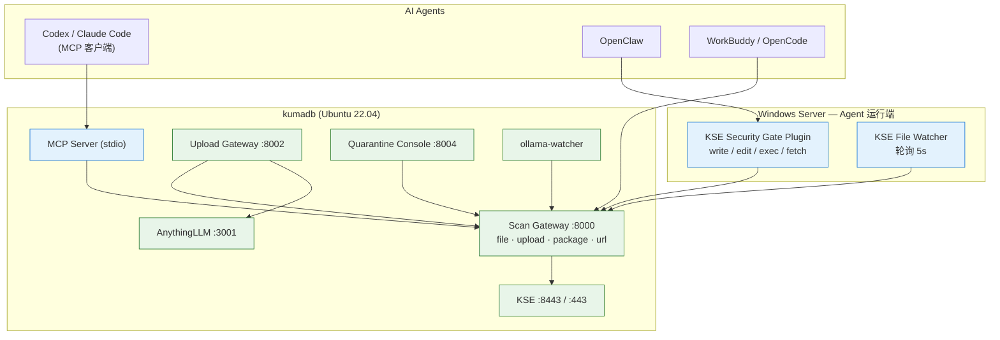

# kse-ai-gateway

[](LICENSE)
[](https://github.com/prellfn/kse-ai-gateway)
[](https://support.kaspersky.com/ScanEngine)

**kse-ai-gateway** 是一套面向 AI Agent 的安全网关与防护体系：基于卡巴斯基扫描引擎
（Kaspersky Scan Engine, KSE），把 AI Agent 的所有高危操作——**工具调用、Skill 下载、脚本执行、
模型加载、URL 访问、知识库文档上传**——统一交给 KSE 扫描判定，实现「**Agent 不裸跑，恶意内容不过网**」。

本仓库包含已在生产环境验证过的完整实现：

| 层次 | 组件 | 说明 |
| --- | --- | --- |
| **扫描核心** | Scan Gateway (:8000) | KSE 封装层：路径白名单、SHA256 缓存、威胁隔离、审计 |
| **接入层** | Upload Gateway (:8002) | 安全上传 → AnythingLLM |
| | **MCP Server** (stdio) | 让 Codex / Claude Code 等原生支持 MCP 的 Agent 零改造接入 |
| | OpenClaw Plugin | `before_tool_call` 事前拦截 write / edit / exec / fetch |
| **兜底层** | KSE File Watcher | Windows 轮询监控 skills / plugins / npm |
| | ollama-watcher | Linux 模型目录监控与自动隔离 |
| **运营层** | Quarantine Console (:8004) | 隔离区人工复核台：复扫 / 恢复 / 删除 / 审计 / 统计 |

---

## 目录

- [它解决什么问题](#它解决什么问题)
- [整体架构](#整体架构)
- [防护能力矩阵](#防护能力矩阵)
- [AI Agent 接入](#ai-agent-接入)
- [仓库结构](#仓库结构)
- [快速开始](#快速开始)
- [核心 API](#核心-api)
- [配置](#配置)
- [判定与处置策略](#判定与处置策略)
- [安全设计原则](#安全设计原则)
- [文档](#文档)
- [路线图](#路线图)
- [许可证](#许可证)

---

## 它解决什么问题

AI Agent（OpenClaw、Codex、WorkBuddy、Claude Code、OpenCode 等）在执行任务时会下载第三方 Skill、
运行脚本、加载模型文件、访问外部链接、调用外部工具、写入知识库。这意味着**不受信任的内容会直接
进入执行环境或数据资产**：

| 风险 | 场景 |
| --- | --- |
| 供应链投毒 | 恶意或被篡改的 Skill / Plugin 包（夹带木马、后门脚本） |
| 压缩包藏毒 | 整包扫描被免杀，但包内某个脚本带毒 |
| 高危脚本落地 | Agent 生成或拉取的脚本中夹带恶意载荷，落地后被直接执行 |
| 模型投毒 | 被劫持的模型仓库 / 权重文件（`.gguf`、`.safetensors`） |
| 钓鱼与恶意链接 | Agent 被诱导访问仿冒登录页、恶意下载站 |
| 知识库污染与宏病毒 | 上传到 RAG / 知识库的文档携带恶意负载或宏代码 |
| 工具返回投毒 | MCP / 工具调用返回的附件或载荷被污染，影响下游系统 |

kse-ai-gateway 在 Agent 与这些操作之间插入一道**强制安全检查点**：所有内容先经 KSE 扫描，
判定通过才放行。

---

## 整体架构



**部署形态**：网关与 KSE 部署在同一台内网主机，网关通过本机回环调用 KSE；Agent 侧只需把请求
指向网关（插件 / MCP / 代理 / 目录监听），无需侵入式改造 Agent 本体。

| 组件 | 部署方式 | 端口 | 作用 |
| --- | --- | --- | --- |
| KSE | 原生 systemd | 8443 (HTTPS) / 443 (Web UI) | 卡巴斯基扫描引擎核心 |
| Scan Gateway | Python + systemd | 8000 | 扫描核心：路径白名单、缓存、隔离、审计 |
| Upload Gateway | Python + systemd | 8002 | 安全上传页面，先扫再入库 |
| Quarantine Console | Python + systemd | 8004 | 隔离区人工复核台 |
| MCP Server | Python (stdio) | — | MCP 协议接入层 |
| ollama-watcher | Bash + systemd | — | 监控模型下载目录，自动隔离 |
| OpenClaw Plugin | Node.js 插件 | — | 事前拦截 write / edit / exec / fetch |
| KSE File Watcher | PowerShell 计划任务 | — | 事后兜底扫描 skills / plugins / npm |
| AnythingLLM | Docker | 3001 | 知识库前端 |

---

## 防护能力矩阵

| # | 场景 | 类型 | 触发方式 | 处置 | 状态 |
| --- | --- | --- | --- | --- | --- |
| 1 | OpenClaw `write` | 事前 · 内存扫描 | Agent 调用 write 工具 | 阻止写入，不落盘 | ✅ 已验证 |
| 2 | OpenClaw `exec` | 事前 · 脚本/模型/Skill | Agent 调用 exec 工具 | 阻止执行 | ✅ 已验证 |
| 3 | OpenClaw `fetch` | 事前 · URL 扫描 | Agent 访问外部链接 | 阻止访问 | ✅ 新增 |
| 4 | Ollama 模型监控 | 事后 · inotifywait | 模型文件写入 blobs | 自动隔离 | ✅ 已验证 |
| 5 | Upload Gateway | 上传拦截 · Web 页面 | 用户上传文件 | 拒绝入库 | ✅ 已验证 |
| 6 | File Watcher | 事后 · 定时轮询 | skills/plugins/npm 安装 | 自动隔离 | ✅ 已验证 |
| 7 | Skill 包深度扫描 | 事后/事前 · 解包逐文件 | 下载或接收压缩包 | 整包隔离 | ✅ 新增 |
| 8 | MCP Server | 工具调用 · Agent 自主 | Agent 主动调用 | 由 Agent 决定阻断 | ✅ 新增 |
| 9 | 隔离区复核台 | 运营 · 人工复核 | 管理员访问 :8004 | 复扫/恢复/删除 | ✅ 新增 |

### ① 工具调用拦截（事前 · 不落盘）

插件挂载在 OpenClaw 的 `before_tool_call` Hook 上。Agent 写文件时，**文件内容先在内存中被扫描**，
检出威胁直接返回 `block: true`，文件根本不会落到磁盘上。

```
Agent → write(path, content)
       → Plugin → Scan Gateway → KSE
       → DETECT ⇒ { block: true, blockReason: "[Kaspersky] 检出威胁: EICAR-Test-File" }
```

### ② 脚本执行拦截（事前 · 不执行）

`exec` 工具命中三类目标：**待执行脚本**（`.py/.js/.sh/.ps1/.exe`）、**待加载模型**
（`.gguf/.safetensors/.bin/.pt/.onnx`）、**Skill 下载命令**（`git clone` / `pip install` /
`npm install` / `curl` / `wget` + Skill 关键词）。此外还会提取命令中的 **URL** 逐个扫描。

### ③ URL 扫描（事前 · 钓鱼与恶意链接）

`web_fetch` / `fetch` / `browse` / `http_request` 类工具在真正发起请求前，URL 先经 KSE
`checkurl` 扫描；`exec` 命令中的 URL 同样会被提取扫描。检出钓鱼站点则阻断访问。

### ④ Skill 包深度扫描（解包逐文件）

针对「整包扫描被免杀、包内单个文件带毒」的场景：压缩包上传后解包，**逐个文件送检**，
任一文件命中威胁即判定整包为 `DETECT` 并整包隔离。同时内置 **Zip Slip 路径穿越**防护、
**压缩包炸弹**防护（成员数、解压体积、压缩比三重阈值）。

### ⑤ Ollama 模型监控（事后 · 自动隔离）

`ollama-watcher` 用 `inotifywait` 旁路监听 `models/blobs/`，新模型文件出现即调用 Scan Gateway，
检出威胁 `mv` 到隔离区并命名为 `{SHA256}_{时间戳}_{原文件名}`，Ollama 加载该模型会失败。

### ⑥ 知识库上传拦截

浏览器上传 → Upload Gateway 落盘扫描队列 → Scan Gateway → KSE → CLEAN 才转发 AnythingLLM
（两步上传：`document/upload` + `workspace/{slug}/update-embeddings`）。

### ⑦ skills / plugins 安装兜底（事后 · 自动隔离）

Windows 计划任务每 5 秒轮询 `workspace` / `plugins` / `npm` 目录，发现新文件即通过
`curl.exe` 上传到 Scan Gateway，检出威胁 Move-Item 到本地隔离区。

### ⑧ MCP Server（原生 Agent 接入）

Codex、Claude Code、Claude Desktop 等客户端只需一份 MCP 配置即可获得 5 个扫描工具，
**无需为每个 Agent 单独开发插件**。详见 [`gateway/mcp-server/README.md`](gateway/mcp-server/README.md)。

### ⑨ 隔离区复核台（运营闭环）

所有被隔离的文件都会带上 `.meta.json` 元数据（威胁名称、SHA-256、原始路径、时间）。
复核台提供复扫验证误报、恢复文件、标记结论、审计流水与威胁统计，让「误报处理」有迹可循。

> 完整数据流时序图见 [`docs/architecture.md`](docs/architecture.md)；
> 交互式架构图见 [`docs/kse_architecture.html`](docs/kse_architecture.html)；
> 完整接口定义见 [`docs/api.md`](docs/api.md)。

---

## AI Agent 接入

三种 Agent 共用**同一个** Scan Gateway 与 KSE，威胁统一隔离、审计统一留痕。
接入层在 [`integrations/`](integrations/) 目录，详见 [接入层说明](integrations/README.md)。

| Agent | 主接入方式 | 拦截时机 | 安装脚本 |
| --- | --- | --- | --- |
| **Codex** | MCP Server + Skill | Agent 主动调用（工具触发） | `integrations/codex/install.ps1` |
| **OpenCode** | 插件 `tool.execute.before` + MCP | **事前自动拦截** | `integrations/opencode/install.sh` |
| **WorkBuddy** | Skill 包 + 下载代理 + MCP | 代理层 + Agent 主动调用 | `integrations/workbuddy/install.sh` |

### Codex（MCP + Skill）

```toml
# ~/.codex/config.toml
[mcp_servers.kse-ai-gateway]
command = "/opt/ai-stack/mcp-venv/bin/python"
args = ["/opt/ai-stack/mcp-server/server.py"]
env = { KSE_SCAN_GATEWAY = "http://127.0.0.1:8000", KSE_SCAN_TIMEOUT = "300" }
enabled = true
```

```powershell
cd integrations/codex
.\install.ps1 -ScanGateway "http://10.0.0.1:8000"
```

Skill `kse-scan` 会告诉 Codex **何时该扫描**（下载 Skill / 跑脚本 / 加载模型 / 访问链接 / 写知识库）。

### OpenCode（插件事前拦截 · 最强）

插件挂 `tool.execute.before` 钩子，在工具执行前扫描并阻断：

| 工具 | 扫描对象 |
| --- | --- |
| `write` / `edit` / `patch` | 写入 / 编辑的内容 |
| `bash` / `shell` / `exec` | 待执行脚本、待加载模型、命令中的 URL |
| `webfetch` / `fetch` / `browse` | 待访问的 URL |

```bash
cd integrations/opencode && ./install.sh
```

### WorkBuddy（Skill 下载代理 · 先扫后装）

```bash
# 安装 Skill + MCP 配置
cd integrations/workbuddy && ./install.sh

# Skill / 插件包「先扫后装」下载代理（Fail-Closed）
./integrations/workbuddy/skill/scripts/download-and-scan.sh \
    https://example.com/some-skill.zip ~/workbuddy/skills/
```

知识库上传则直接把上传地址指向 Upload Gateway（`:8002`），「先扫后入库」是默认行为。

### 通用 MCP 配置

任何支持 MCP 的客户端都直接用 `gateway/mcp-server`（stdio），5 个工具：
`scan_file` / `scan_text` / `scan_url` / `scan_skill_pkg` / `kse_status`。

```json
{
  "mcpServers": {
    "kse-ai-gateway": {
      "command": "python3",
      "args": ["/opt/ai-stack/mcp-server/server.py"],
      "env": { "KSE_SCAN_GATEWAY": "http://127.0.0.1:8000", "KSE_SCAN_TIMEOUT": "300" }
    }
  }
}
```

---
## 仓库结构

```
kse-ai-gateway/
├── gateway/
│   ├── scan-gateway/
│   │   └── app.py                 # :8000  扫描核心（file/upload/package/url/directory）
│   ├── upload-gateway/
│   │   ├── app.py                 # :8002  安全上传 → AnythingLLM
│   │   └── templates/index.html   # 上传页面
│   ├── quarantine-console/
│   │   ├── app.py                 # :8004  隔离区复核台
│   │   └── templates/index.html   # 复核台页面
│   ├── mcp-server/
│   │   ├── server.py              # MCP Server (stdio)
│   │   ├── requirements.txt
│   │   └── README.md
│   ├── systemd/
│   │   ├── scan-gateway.service
│   │   ├── upload-gateway.service
│   │   ├── quarantine-console.service
│   │   └── ollama-watcher.service
│   └── requirements.txt
├── agent/
│   ├── openclaw-plugin/           # OpenClaw 插件：write/edit/exec/fetch 事前拦截
│   │   ├── index.js
│   │   ├── package.json
│   │   ├── openclaw.plugin.json
│   │   └── README.md
│   └── windows-watcher/
│       ├── kse-file-watcher.ps1   # Windows 轮询监控 + 隔离
│       └── README.md
├── watchers/
│   └── ollama-watcher.sh          # Linux 模型目录监控 + 自动隔离
├── integrations/                  # AI Agent 接入层
│   ├── README.md                  # 三种 Agent 接入总览与对比
│   ├── common/kse-client.js       # 共用 Node 客户端库
│   ├── codex/                     # Codex: config.toml + Skill + install.ps1
│   ├── opencode/                  # OpenCode: 插件 + opencode.json + install.sh
│   └── workbuddy/                 # WorkBuddy: Skill + 下载代理 + install.sh
├── scripts/
│   ├── install_ubuntu.sh          # Linux 一键部署网关
│   └── backup_kse.sh              # 备份 / 恢复脚本
├── config/
│   └── gateway.example.yaml       # 全量配置示例
├── docs/
│   ├── install.md                 # 安装手册
│   ├── operations.md              # 运维手册
│   ├── api.md                     # API 参考
│   ├── architecture.md            # 架构拓扑与数据流
│   └── kse_architecture.html      # 交互式架构图
├── .env.example
└── pyproject.toml
```

---

## 快速开始

### 前置要求

- **Kaspersky Scan Engine 2.2.x**（已启用 HTTPS + Token，端口 8443）
- **Ubuntu 22.04 LTS**（网关侧）/ **Windows Server**（Agent 侧）
- Docker 20.10+（仅 AnythingLLM 需要）

### 1. 安装 KSE 并配置 Token

详见 [`docs/install.md`](docs/install.md) 第三、四章。要点：

> ⚠️ **必须用 Web UI 配置 Token，不要手动改 XML。**
> 调用 API 用的是**明文 Token**，不是 XML 里的 88 字节加密值。

### 2. 一键部署网关

```bash
git clone https://github.com/prellfn/kse-ai-gateway.git
cd kse-ai-gateway
sudo ./scripts/install_ubuntu.sh
```

脚本会完成：创建目录 → 安装 Python 依赖 → 部署 4 个服务 → 注册 systemd → 生成 MCP 配置模板。
部署后编辑 `.env` 填入 `KSE_TOKEN` 并重启：

```bash
sudo vi /opt/ai-stack/scan-gateway/.env
sudo systemctl restart scan-gateway upload-gateway quarantine-console
```

### 3. 验证

```bash
curl http://127.0.0.1:8000/health    # Scan Gateway
curl http://127.0.0.1:8002/health    # Upload Gateway
curl http://127.0.0.1:8004/health    # 隔离区复核台

# EICAR 端到端测试
echo 'X5O!P%@AP[4\PZX54(P^)7CC)7}$EICAR-STANDARD-ANTIVIRUS-TEST-FILE!$H+H*' \
  > /opt/kaspersky/scanqueue/eicar.txt
curl -X POST http://127.0.0.1:8000/scan/file \
  -H "Content-Type: application/json" \
  -d '{"file_path":"/opt/kaspersky/scanqueue/eicar.txt","timeout":60}'
```

预期返回 `verdict: DETECT`，且文件已被移入 `/opt/kaspersky/quarantine/`。
复核台打开 `http://<host>:8004` 即可看到该文件并执行复扫 / 恢复 / 删除。

### 4. 接入 AI Agent

| Agent | 接入方式 |
| --- | --- |
| **Codex / Claude Code / Claude Desktop** | MCP 配置，见 [`gateway/mcp-server/README.md`](gateway/mcp-server/README.md) |
| **OpenClaw** | 插件，见 [`agent/openclaw-plugin/README.md`](agent/openclaw-plugin/README.md) |
| **Windows skills 兜底** | 计划任务，见 [`agent/windows-watcher/README.md`](agent/windows-watcher/README.md) |
| **知识库上传** | 浏览器访问 `http://<host>:8002` |

---

## 核心 API

完整定义见 **[`docs/api.md`](docs/api.md)**。

### Scan Gateway（:8000）

| 方法 | 路径 | 说明 |
| --- | --- | --- |
| `POST` | `/scan/file` | 扫描本机文件（路径白名单内），命中威胁自动隔离 |
| `POST` | `/scan/upload` | 上传文件内容扫描（跨机器调用统一入口） |
| `POST` | `/scan/package` | **压缩包解包逐文件深度扫描** + Zip Slip / 炸弹防护 |
| `POST` | `/scan/url` | **URL 扫描**（钓鱼站点 / 恶意链接） |
| `POST` | `/scan/directory` | 批量扫描目录下所有文件 |
| `GET` | `/health` | 健康检查 |

### Quarantine Console（:8004）

| 方法 | 路径 | 说明 |
| --- | --- | --- |
| `GET` | `/api/quarantine` | 列出隔离文件（支持状态 / 关键字过滤） |
| `POST` | `/api/quarantine/{id}/rescan` | **复扫验证误报** |
| `POST` | `/api/quarantine/{id}/restore` | **恢复到原始路径** |
| `POST` | `/api/quarantine/{id}/mark?status=` | 标记结论：误报 / 已确认威胁 / 待复核 |
| `DELETE` | `/api/quarantine/{id}` | 永久删除 |
| `GET` | `/api/audit?limit=100` | 审计流水 |
| `GET` | `/api/stats` | 威胁统计 |

---

## 配置

所有配置通过**环境变量**注入（`.env`），模板见 [`.env.example`](.env.example)，
结构化示例见 [`config/gateway.example.yaml`](config/gateway.example.yaml)。

```bash
# ---- KSE ----
KSE_URL=https://127.0.0.1:8443
KSE_TOKEN=your-kse-plaintext-token     # 明文 Token，勿提交
KSE_TIMEOUT=120
KSE_VERIFY_TLS=false

# ---- 目录 ----
SCAN_QUEUE=/opt/kaspersky/scanqueue
QUARANTINE=/opt/kaspersky/quarantine
ALLOWED_SCAN_DIRS=/opt/kaspersky/scanqueue,/opt/kaspersky/quarantine,/root/ai-stack/ollama/models/blobs
AUDIT_LOG=/opt/ai-stack/scan-gateway/logs/audit.jsonl

# ---- 压缩包解包保护 ----
MAX_ARCHIVE_MEMBERS=5000
MAX_ARCHIVE_UNPACKED=524288000
MAX_COMPRESSION_RATIO=100

# ---- MCP Server ----
KSE_SCAN_GATEWAY=http://127.0.0.1:8000
KSE_SCAN_TIMEOUT=300

# ---- AnythingLLM ----
ANYTHINGLLM_URL=http://10.0.0.1:3001
ANYTHINGLLM_API_KEY=your-anythingllm-api-key
WORKSPACE_SLUG=your-workspace-slug
```

---

## 判定与处置策略

| KSE 返回 | 网关判定 | Upload Gateway | OpenClaw Plugin | MCP Server |
| --- | --- | --- | --- | --- |
| `CLEAN` | clean | ✅ 放行入库 | ✅ 放行 | ✅ 放行 |
| `DETECT` / `INFECTED` | malicious | ⛔ 拒绝 + 隔离 | ⛔ 阻止工具调用 | ⛔ 明确告警 |
| 启发式可疑 | suspicious | 🚧 隔离待审 | ⛔ 阻止 | ⛔ 告警 |
| 超时 / 扫描异常 | error | ⛔ **Fail-Closed** 拒绝 | ✅ **Fail-Open** 放行 | ⚠️ 抛错 |

> 两种 Fail 策略的取舍：Agent 侧优先保证业务不中断（事后由 Watcher 兜底）；
> 知识库侧优先保证数据不被污染（宁可拒绝入库）。MCP Server 抛错由客户端策略决定。

---

## 安全设计原则

- **默认拒绝（Fail-Closed）**：未知路由、超限文件、KSE 不可达或超时一律不放行。
- **最小暴露**：网关与 KSE 之间仅走本机回环；KSE API（8443）、Scan Gateway（8000）
  与复核台（8004）不对公网开放，只允许内网访问。
- **路径白名单**：Scan Gateway 只扫描 `ALLOWED_SCAN_DIRS` 内的文件，杜绝任意路径读取。
- **解包安全**：Zip Slip 路径穿越、压缩包炸弹（成员数 / 解压体积 / 压缩比）三重防护。
- **全量审计**：请求来源、文件 SHA-256、KSE 检测名、耗时、处置动作写入 JSONL 审计日志；
  复核台的每一次人工操作同样入账。
- **隔离优先 + 闭环**：可疑文件自动隔离并带元数据，人工复核结论可追溯。
- **密钥不落库**：KSE Token / AnythingLLM API Key 只存于 `.env`（权限 600），仓库只保留模板。

---

## 文档

| 文档 | 内容 |
| --- | --- |
| [`docs/install.md`](docs/install.md) | 完整安装手册（11 步，含全部命令与验证） |
| [`docs/operations.md`](docs/operations.md) | 运维手册（服务管理、日志、故障排查、病毒库更新、备份恢复） |
| [`docs/api.md`](docs/api.md) | API 参考（4 个服务的完整接口定义） |
| [`docs/architecture.md`](docs/architecture.md) | 架构拓扑与数据流时序图 |
| [`docs/kse_architecture.html`](docs/kse_architecture.html) | 交互式架构图（浏览器打开） |
| [`gateway/mcp-server/README.md`](gateway/mcp-server/README.md) | MCP Server 接入说明 |
| [`integrations/README.md`](integrations/README.md) | Codex / OpenCode / WorkBuddy 接入说明 |
| [`agent/openclaw-plugin/README.md`](agent/openclaw-plugin/README.md) | OpenClaw 插件接入说明 |
| [`agent/windows-watcher/README.md`](agent/windows-watcher/README.md) | Windows 监控接入说明 |

---

## 路线图

- [x] KSE HTTP API 对接与判定解析
- [x] Scan Gateway（路径白名单 + 缓存 + 隔离 + 审计）
- [x] Upload Gateway（安全上传 → AnythingLLM）
- [x] OpenClaw 插件：write / edit / exec 事前拦截
- [x] Windows File Watcher：skills / plugins / npm 兜底扫描
- [x] Ollama 模型下载监控与自动隔离
- [x] MCP Server 形态接入（Codex / Claude Code 等原生支持 MCP 的 Agent）
- [x] URL 扫描链路（`/scan/url`，拦截恶意链接与钓鱼 URL）
- [x] Skill / 插件包解包逐文件深度扫描 + 压缩包炸弹防护
- [x] 隔离区 Web 复核台（复扫 / 恢复 / 审计 / 统计）
- [ ] 双向 TLS（mTLS）与多租户策略
- [ ] 复核台接入统一登录鉴权（OIDC / LDAP）
- [ ] 威胁情报聚合（多引擎联动 + 灰度处置）
- [ ] 扫描结果缓存跨实例共享（Redis）
- [ ] Agent 侧策略中心（按 Agent / 按工具粒度下发策略）

---

## 许可证

本项目采用 [MIT License](LICENSE) 开源许可证。
Kaspersky Scan Engine 为卡巴斯基商业产品，需自行获取许可证，本仓库不含任何 KSE 二进制或密钥。
