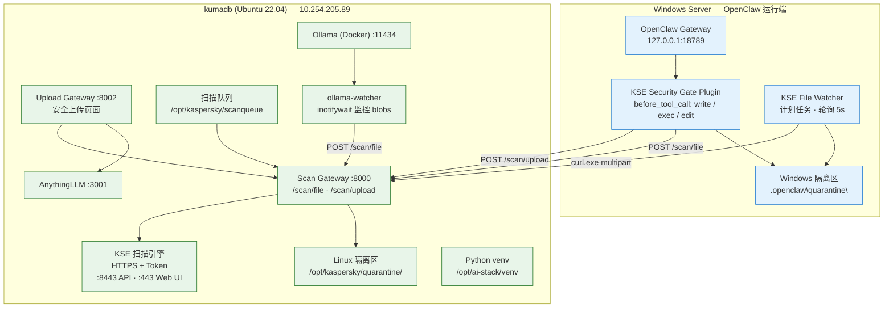
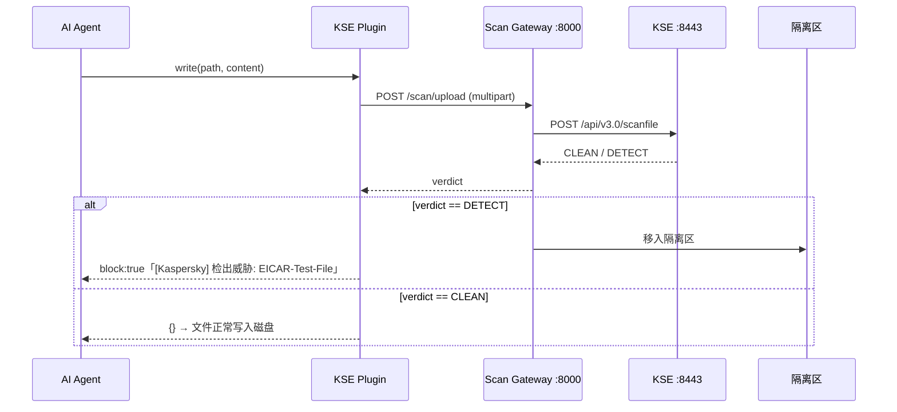
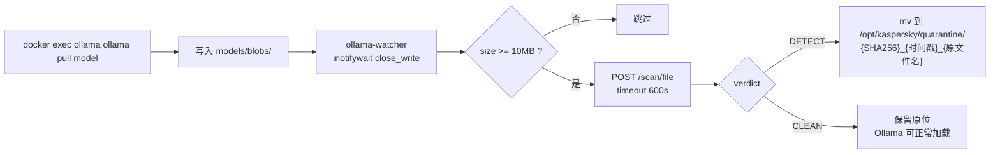
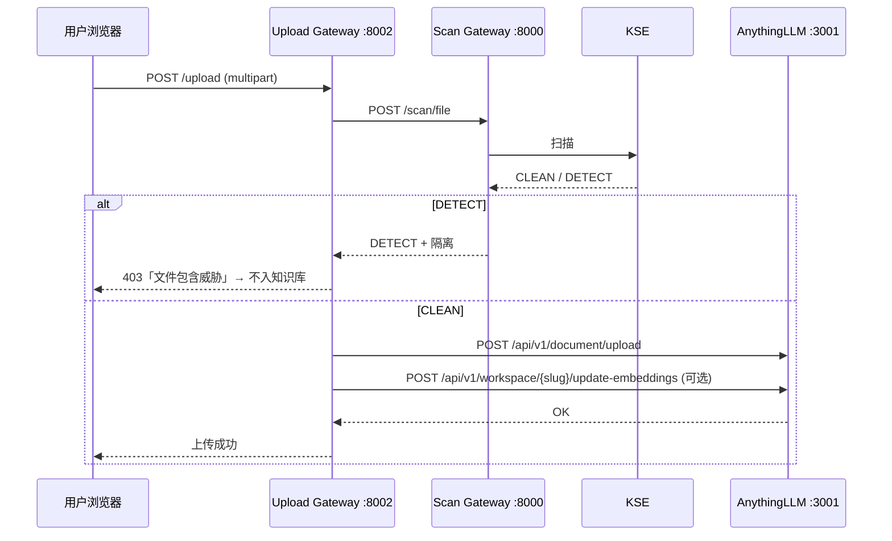
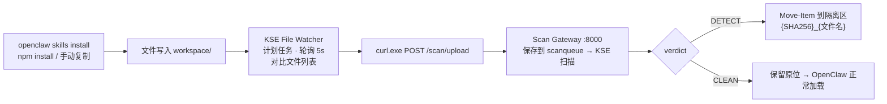

# 架构拓扑与数据流

> 交互式架构图源文件：`docs/kse_architecture.html`（浏览器打开可切换视图）。

## 1. 整体拓扑

---

## 2. 五条防护数据流

### 数据流 ①：OpenClaw `write` 工具拦截（事前拦截 · 内存扫描）

**关键特点**

- 文件内容在**写入磁盘前**就被扫描（内存中拦截），不落盘
- 扫描所有文件类型，不限扩展名（`.txt`/`.py`/`.js`/`.sh` 全部扫描）
- 跨机器调用：Windows Plugin → HTTP → Linux Scan Gateway → KSE
- 超时/异常自动 **fail-open** 放行，不影响 OpenClaw 正常使用
- 威胁文件副本保存在 kumadb 隔离区，便于审计和溯源

> **已验证**：EICAR-Test-File 被成功拦截。

### 数据流 ②：OpenClaw `exec` 工具拦截（三类检测，事前拦截）

| 类型 | 检测方式 | 示例 |
| --- | --- | --- |
| A. 脚本文件 | 正则提取 command 中的脚本路径 `.py/.js/.ts/.sh/.bat/.ps1/.exe` → `/scan/file` | `python C:\temp\test.py` |
| B. 模型文件 | 正则提取模型路径 `.gguf/.safetensors/.bin/.pt/.onnx` → `/scan/file` | `ollama run /path/model.gguf` |
| C. Skill 下载命令 | 检测下载关键词 + Skill 关键词 → 扫描命令文本本身 | `git clone` / `pip install` / `npm install` |

检出威胁 → 返回 `{ block: true, blockReason: "[Kaspersky] 检出威胁: ..." }`，脚本/模型不执行，Skill 不下载。

> **注意**：exec 拦截扫描的是 Windows 本地文件（脚本/模型），通过 `/scan/upload` 上传内容扫描；
> Skill 下载命令扫描的是**命令文本内容本身**，不是下载后的文件（文件下载后由 File Watcher 兜底）。

### 数据流 ③：Ollama 模型下载监控与自动隔离（事后扫描）

- **零侵入**：不改 Ollama 代码，只旁路监听文件系统
- **fail-open**：扫描异常不隔离，只记录日志
- 大模型友好：<10MB 跳过，超时 600 秒

> **已验证**：12MB EICAR 测试文件被成功检出并自动隔离。

### 数据流 ④：Upload Gateway 安全上传扫描（上传拦截）

**安全特性**

- `add_to_workspace` 参数控制入库范围
- SHA256 缓存避免重复扫描
- 威胁文件自动隔离 + 记录

### 数据流 ⑤：Windows 文件监控（skills / plugins / npm 安装扫描，事后兜底）

**关键特点与设计取舍**

- **定时轮询(5s)而非 FileSystemWatcher**：Windows 上 FSW 子目录监控不可靠，轮询 100% 稳定
- **curl.exe 上传而非 Invoke-RestMethod -Form**：兼容 PowerShell 5.1（`-Form` 是 6.1+ 才有）
- **纯英文注释 + UTF-8 BOM**：避免 PowerShell 5.1 中文乱码导致脚本解析失败
- **排除目录** `\out\` `\state\` `\.clawhub\`：不扫 agent 输出文件和元数据，减少噪音
- **超 100MB 跳过**：大文件不扫描，避免影响性能（模型文件由 Ollama 监控覆盖）
- **与 Plugin 互补**：Plugin 是事前拦截（write/exec），Watcher 是事后兜底（skills install/npm install）

> **已验证**：EICAR 测试文件被检出并隔离；tmux skill 安装文件全部扫描通过（CLEAN）。

---

## 3. 五种防护场景对比

| 场景 | 类型 | 触发方式 | 处置 |
| --- | --- | --- | --- |
| OpenClaw `write` | 事前拦截 · 内存扫描 | Agent 调用 write 工具 | ✓ 不落盘 |
| OpenClaw `exec` | 事前拦截 · 脚本/模型/Skill | Agent 调用 exec 工具 | ✓ 不执行 |
| Ollama 监控 | 事后扫描 · inotifywait | 模型文件写入 blobs | ✓ 自动隔离 |
| Upload Gateway | 上传拦截 · Web 页面 | 用户上传文件 | ✓ 不入知识库 |
| File Watcher | 事后扫描 · 定时轮询 | skills/plugins/npm 安装 | ✓ 自动隔离 |

---

## 4. 核心设计原则

- 所有场景**共用同一个 KSE 扫描引擎和 Scan Gateway**，威胁统一隔离
  （Linux 端 `/opt/kaspersky/quarantine/`，Windows 端 `.openclaw\quarantine\`）
- **Fail-Closed**：Upload Gateway 扫描异常 → 拒绝入库
- **Fail-Open**：OpenClaw Plugin 扫描异常 → 放行，不阻断 Agent 业务
- **最小侵入**：不改 Agent 本体，通过插件 Hook / 目录监听 / 上传代理接入
- **全链路可审计**：JSONL 审计日志记录 请求来源、SHA-256、判定结果、处置动作

---

## 5. 与 Agent 的接入方式

| Agent | 接入方式 |
| --- | --- |
| **OpenClaw** | `before_tool_call` 插件 Hook（write / edit / exec）+ File Watcher 兜底 |
| **Codex** | 通过 MCP / 本地 Hook 调用 Scan Gateway `/scan/upload` |
| **WorkBuddy** | Skill 下载代理 + 知识库上传安全端点 |
| **OpenCode** | 工具端点代理 + 脚本执行前置扫描 Hook |
